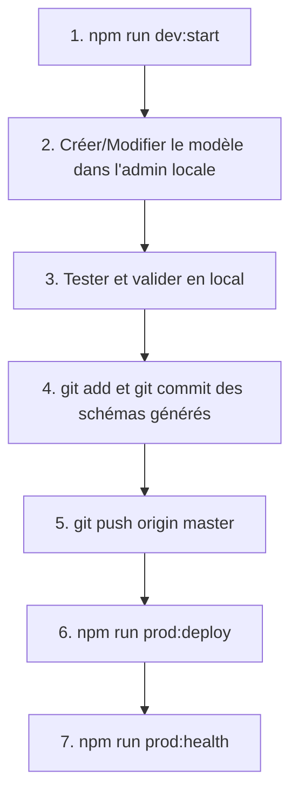

# 🛒 Mon Strapi CMS (Projet IRIS) — Guide Collaboratif

Ce dépôt contient le backend headless **Strapi 5** (TypeScript) pour la gestion du catalogue de produits et des catégories e-commerce.

---

## 🌐 Liens Utiles & Production

L'application est hébergée en production sur **Heroku** avec une base de données managée **Heroku Postgres** et le stockage des médias sur **Cloudinary** :

| Service | URL | Description |
|---|---|---|
| **API en Production** | `https://mon-strapi-cms-d348002bd1ec.herokuapp.com` | Base URL pour les requêtes frontend |
| **Panneau Admin Prod** | `https://mon-strapi-cms-d348002bd1ec.herokuapp.com/admin` | Gestion du contenu en ligne |
| **Healthcheck Prod** | `https://mon-strapi-cms-d348002bd1ec.herokuapp.com/_health` | Statut du serveur (répond `HTTP 204`) |
| **Documentation Swagger** | `https://mon-strapi-cms-d348002bd1ec.herokuapp.com/documentation/v1.0.0` | Spécification OpenAPI interactive |
| **Environnement Local** | `http://localhost:1337` / `http://localhost:1337/admin` | Serveur de développement |

---

## 🏗️ Architecture & Environnements

| Composant | En Local (Développement) | En Production (Heroku) |
|---|---|---|
| **Exécution** | Node 24 (`npm run dev:start`) | Dyno Web Heroku (`npm start`) |
| **Base de données** | Postgres 16 sous Docker (`compose.yaml` inclus dans le repo) | Add-on Heroku Postgres |
| **Médias (images)** | Stockage local (`public/uploads`) | Cloudinary (disque Heroku éphémère) |
| **Content-Type Builder** | **Actif** (création/modification de modèles) | **Désactivé** (`NODE_ENV=production`) |
| **Variables d'env** | Fichier `.env` local (non versionné) | Variables `heroku config:set` |

> ⚠️ **Règle d'or Strapi v5** :  
> Le **Content-Type Builder est désactivé en production**. Tout nouveau modèle ou modification de champ doit obligatoirement être créé en local, testé, commité sur Git (`src/api/...`), puis déployé.

---

## 🚀 Démarrage Rapide (Pour les collaborateurs)

### 1. Pré-requis
- **Node.js** : version `24.x` (vérifier avec `node -v`)
- **Docker & Docker Compose** (pour la base PostgreSQL locale)
- **Git**

### 2. Cloner et installer les dépendances
```bash
git clone https://github.com/koddyb/mon-strapi-cms.git
cd mon-strapi-cms # ou se placer dans le dossier cms-headless/
npm install
```

### 3. Configurer l'environnement
Copiez le fichier d'exemple pour créer votre `.env` local :
```bash
cp .env.example .env
```
*(Le fichier `.env` contient déjà la configuration par défaut pour pointer vers le Postgres Docker local).*

### 4. Lancer le projet en local
Une seule commande suffit pour démarrer la base Docker et le serveur Strapi :
```bash
npm run dev:start
```
- Le panneau d'administration sera disponible sur : **http://localhost:1337/admin**
- À la première ouverture, créez votre compte administrateur local.

### 5. Peupler la base avec les données de test (Optionnel)
Pour injecter automatiquement 10 produits avec leurs catégories et images HD :
```bash
npm run seed
```

---

## 🛠️ Répertoire des Scripts NPM

Tous les scripts s'exécutent depuis le dossier `cms-headless/` :

### 💻 Développement & Base de données locale

| Script | Description |
|---|---|
| `npm run dev:start` | Démarre le conteneur Postgres Docker (attend qu'il soit prêt) puis lance Strapi en mode développement avec rechargement à chaud. |
| `npm run develop` | Lance uniquement le serveur Strapi (si Postgres Docker tourne déjà). |
| `npm run seed` | Télécharge et injecte 10 produits High-Tech complets avec images et catégories dans la base. |
| `npm run db:up` | Démarre le conteneur Docker Postgres en arrière-plan. |
| `npm run db:down` | Arrête le conteneur Docker Postgres. |
| `npm run db:status` | Vérifie l'état de santé du conteneur Postgres (`pg_isready`). |
| `npm run db:logs` | Affiche les logs en continu du conteneur Postgres. |
| `npm run db:psql` | Ouvre une session console SQL `psql` interactive dans la base de données locale. |
| `npm run backup` | Exporte une sauvegarde complète chiffrée ou non chiffrée dans le dossier `backups/`. |

---

### 🚀 Déploiement & Santé en Production

| Script | Description |
|---|---|
| `npm run predeploy` | Exécute **6 gardes-fous stricts** avant déploiement (vérification des schémas commités, build TypeScript, dépendance `pg`, variables d'environnement Heroku). |
| `npm run prod:deploy` | Lance `predeploy`, puis pousse la branche courante sur `heroku master` pour déclencher le build et la mise en production. |
| `npm run prod:health` | Interroge l'URL de santé de production `/_health` (doit renvoyer `HTTP 204`). |
| `npm run prod:logs` | Affiche en direct le flux des logs du serveur Heroku. |
| `npm run prod:ps` | Affiche l'état des dynos Heroku (actif, en veille, etc.). |
| `npm run prod:pg` | Affiche les métriques de la base Postgres en production (taille, connexions). |
| `npm run prod:open` | Ouvre directement l'application de production dans votre navigateur par défaut. |

---

### 🔄 Synchronisation du Contenu (Local ↔ Production)

| Script | Description |
|---|---|
| `npm run sync:pull` | Rapatrie le contenu et les médias de la production vers votre base locale (écrase la base locale en créant un backup préalable). |
| `npm run sync:push` | Pousse le contenu local vers la production (opération destructive nécessitant confirmation explicite). |

---

## 🔄 Workflow de Déploiement en Équipe

Pour ajouter un nouveau modèle de données ou une fonctionnalité :



1. **Création locale** : Modifiez le schéma dans `http://localhost:1337/admin`.
2. **Commit** : Vérifiez que les fichiers suivants sont bien inclus dans votre commit :
   - `src/api/<nom>/content-types/<nom>/schema.json`
   - `types/generated/contentTypes.d.ts`
3. **Push sur GitHub** : `git push origin master`
4. **Déploiement Heroku** :
   ```bash
   npm run prod:deploy
   ```
5. **Permissions API** :
   Une fois le déploiement terminé, connectez-vous à l'admin de production (`https://mon-strapi-cms-d348002bd1ec.herokuapp.com/admin`), puis ouvrez les droits de lecture :
   - Rendez-vous dans **Settings** > **Users & Permissions plugin** > **Roles** > **Public**
   - Cochez les cases `find` et `findOne` pour les collections voulues, puis enregistrez.

---

## 📡 Guide de Consommation de l'API (Frontend / Client)

### Authentification
- Si la route est ouverte en **Public** : aucun header requis.
- Si la route est protégée par un **Token API** :
  ```http
  Authorization: Bearer <VOTRE_API_TOKEN>
  ```

### Endpoints Principaux

| Ressource | Méthode | URL |
|---|---|---|
| **Tous les produits** | `GET` | `https://mon-strapi-cms-d348002bd1ec.herokuapp.com/api/produits` |
| **Produits avec images & catégories** | `GET` | `https://mon-strapi-cms-d348002bd1ec.herokuapp.com/api/produits?populate=*` |
| **Un produit par DocumentId** | `GET` | `https://mon-strapi-cms-d348002bd1ec.herokuapp.com/api/produits/:documentId?populate=*` |
| **Toutes les catégories** | `GET` | `https://mon-strapi-cms-d348002bd1ec.herokuapp.com/api/categories?populate=*` |
| **Filtrer par catégorie** | `GET` | `https://mon-strapi-cms-d348002bd1ec.herokuapp.com/api/produits?filters[category][slug][$eq]=audio-casques&populate=*` |

### 📌 Spécificités Strapi v5 à retenir
1. **Pas de wrapper `attributes`** : Les propriétés sont directement accessibles à la racine de chaque objet (ex: `produit.title`, `produit.slug`).
2. **Identifiant `documentId`** : Pour cibler un élément spécifique dans l'URL ou dans une relation, utilisez toujours la chaîne alphanumérique `documentId` (ex: `zbb6w7cyc6sqf1zx64k7wif0`), et non le simple `id` numérique.
3. **Le paramètre `?populate=*`** : Strapi n'inclut pas les images et relations par défaut pour préserver la bande passante. Pensez à ajouter `?populate=*` pour recevoir les médias et les liens relationnels.
